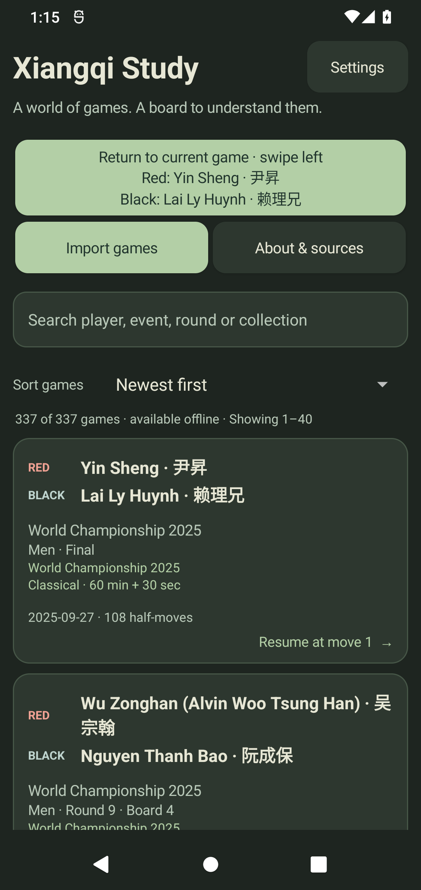
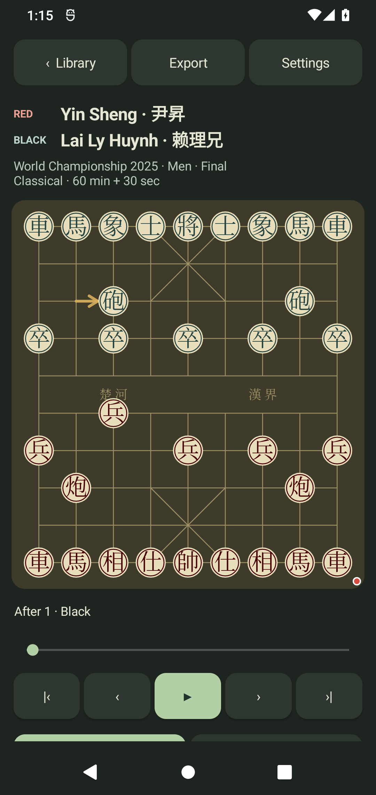
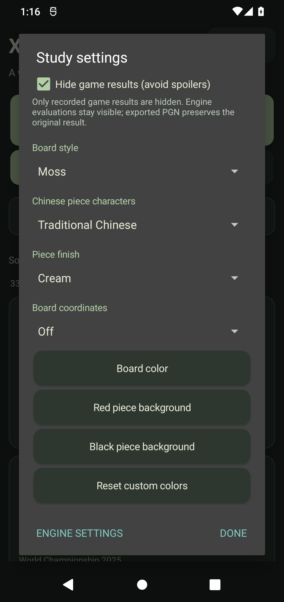
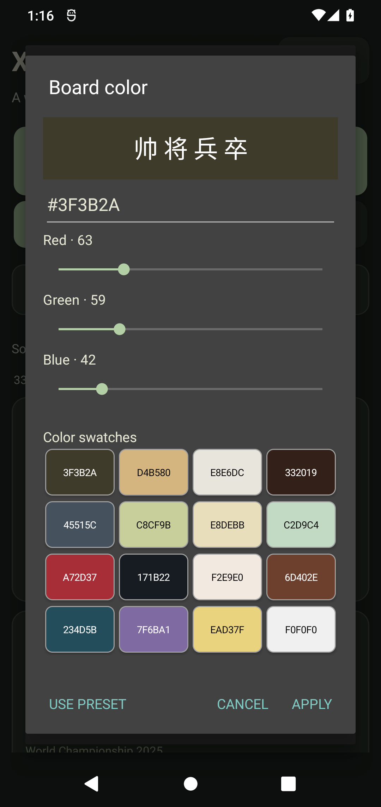
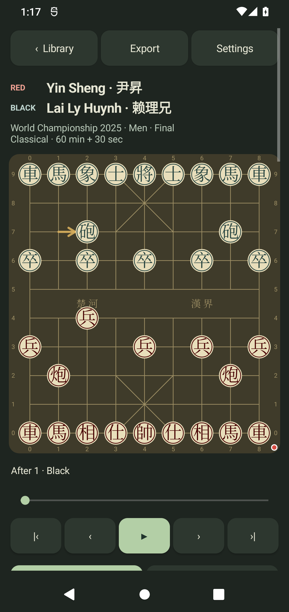

# Xiangqi Study 0.3.0 audit — 2026-10-28

The current phone delivery is `dist/XiangqiStudy-latest.apk`. It upgrades the
existing debug-signed installation while preserving private games and settings.
Older delivery APKs are removed only after a verified replacement exists.
The x86 portable APK is an internal audit artifact under `test-results/apk-audit`.

Final APK: **51,939,131 bytes**, SHA-256
`05cc1b736cdacc5d6ecd8beb147c7dd2230e7d28c394fc3e4d928353c5938d40`.
The connected phone's installed base APK was SHA-256 checked against this exact
delivery. The temporary instrumentation package was removed after testing.

## Changes and defects found

- Removed the visible side-to-move text that wrapped a long player name and
  shifted replay controls. A fixed-size dot on the board changes ends by turn
  and follows a flipped board. The board retains spoken turn/player information.
  Long-name regression compares complete board/slider bounds over nine plies.
- Romanized display names cover all 110 Chinese source-name variants in the
  preload, using bilingual federation lists and contemporary records. Search
  accepts Chinese, established spellings, user aliases and accent-free Latin
  text. Original game names remain intact in stored/exported records.
- Date order, six board palettes, six Chinese-only disc finishes and independent
  opaque RGB board/Red-disc/Black-disc colors persist. Coordinates use the same
  board geometry as the hidden-coordinate view at 320/393 dp, with both flips.
- Added 52 sourced historical master games from 1991–2003. The complete library
  is 337 classical games / 28,177 half-moves. Partial dates and missing exact
  historical clocks remain explicit. See [historical sources](HISTORICAL-SOURCES.md).
- An exact native root draw can contain an empty PV before its legal bestmove.
  The parser now retains that completed score/depth. Invalid nonempty PV moves
  remain rejected. A 333-ply historical game is a native regression fixture.
- Imported study FEN counters beyond the native parser's supported ranges are
  normalized at the UCI boundary, preserving the board and turn. Ordinary recorded
  histories remain complete; source/export counters are unchanged. Such imported
  clocks cannot establish a historical draw claim.
- Native child cleanup now includes a bounded reap after destruction. Windows
  fixture cleanup retries transient file locks before starting its next case.
- The expanded library exposed a real startup ANR: its main thread constructed
  all cards eagerly (`TextView.readTextAppearance → MainActivity.renderCards`).
  Library rendering is now bounded to 40 games per page, while search/sort cover
  the complete collection. This was found during the runtime audit, after the
  initial emulator System UI failures had obscured the app-specific issue.
- The same eager-rendering risk existed for a maximum-length 2,000-ply import.
  The move list now renders at most 40 full-move rows around the current position,
  while the source history, slider range and export remain complete. A 2,000-ply
  legal-loop regression checks start/middle/end windows and stable board bounds.

## Audit rounds

Round 1 checks rules, import/parser boundaries, date/name coverage and every
recorded move. Round 2 exercises Android rendering and user flows; findings are
repaired and the affected checks rerun. Round 3 independently reviews integration,
verifies the clean native APK, and executes the real ARM64 engine on Android 12.

| Check | Current evidence |
| --- | --- |
| Core rules/parser/search/UCI | 170 assertions pass; perft 44 / 1,920 / 79,666 |
| Date precision/order | 27 assertions pass |
| Readable names/source coverage | 354 assertions pass |
| Full collection replay | All 337 games / 28,177 half-moves legal |
| Independent legal-move oracle | Java agrees with official Pikafish at 259 positions |
| Official Windows native corpus | 1,377 positions; 1,353 legal best moves and 24 terminal boards pass |
| Production native adapter with JVM Android stubs | 35 assertions pass, including corruption repair, live updates, empty-PV draw, errors, timeout and cancellation |
| Physical Android 12 ARM64 | Two native tests pass on the exact final APK in 30.513 seconds: 15 recorded/custom/check/variation positions and untimed cancellation |
| Final full Android UI rerun | 33 tests pass in 147.970 seconds after pagination; the two native-only tests explicitly report NOT_RUN on x86, and are separately passed on the phone |
| Clean build/lint/signature/payload | Native and internal portable clean builds pass; lint has no issues; native APK v2 signature and exact payload hashes verify |

Native corpus `perft` reconstructs the engine's FEN and rejects a Rule60 clock
of 120, even when normal search accepts the full game history. The audit inspects
the native FEN, verifies its board/turn against Java, resets that clock for one
geometry-only `perft` case, and restores the original complete history before
search. The physical phone also analyzes that complete 333-ply history as a draw.

The initial emulator run completed 31 tests with two failures and one error while
a System UI ANR dialog captured input. A restarted-emulator run exposed the
library's own eager-rendering ANR, which prompted pagination. A physical-phone
UI attempt was stopped when the device entered its always-on/locked screen;
its local private-data backup was restored. The two headless native-phone tests
completed successfully. Restoration of all four private files was verified
byte-for-byte against that backup. These interrupted runs are retained in
`test-results`.

## Engine release and build guard

The official latest stable release was checked online during the native build:
[Pikafish 2026-09-06](https://github.com/official-pikafish/Pikafish/releases/tag/Pikafish-2026-09-06).
The executable and NNUE come from the same SHA-verified official archive.
`scripts/sync-pikafish.py` derives fresh hashes/metadata from those archive bytes,
verifies or repairs engine/network/licenses, and generates `PikafishRelease.java`.
Every native Gradle preBuild runs this guard; network or verification failure
aborts the build. Production APK verification repeats the latest-release check.

Independent updater regressions rejected forged local metadata, corrupted NNUE,
missing licenses and unsafe archive names. Publication regressions checked atomic
replacement, preservation on pre-publication failure, safe old-app-APK removal,
unrelated APK retention, and junction rejection. ZIP duplicate entries and
conflicting portable/native verification modes are rejected.

## Reproduce

```powershell
.\scripts\test-core.ps1
python scripts/audit-moves.py --engine C:\path\to\Pikafish-Windows-x86-64-universal.exe
python scripts/test-native-adapter.py --engine C:\path\to\Pikafish-Windows-x86-64-universal.exe
python scripts/test-native-pack.py --engine C:\path\to\Pikafish-Windows-x86-64-universal.exe
.\scripts\build.ps1 -Portable -Check
# Install portable + androidTest APK on an x86 Android 12 emulator, then:
adb -s emulator-5554 shell am instrument -w org.xiangqi.study.test/android.test.InstrumentationTestRunner
.\scripts\build.ps1 -Check
python scripts/verify-apk.py dist/XiangqiStudy-latest.apk
# The ARM64 phone audit uses -e class org.xiangqi.study.NativeDeviceTest.
```

Detailed local logs and private test backups stay ignored under `test-results`.
Earlier [0.2](AUDIT.md) and [0.1](VALIDATION.md) reports are historical evidence.
Passing these checks does not prove absence of every possible bug or supply full
WXF tournament arbitership. Real-device engine evidence is explicitly separated
from emulator rendering and Windows-engine evidence.

## Inspected final Android 12 screenshots

These show the final UI on the x86 emulator. The delivered ARM64 APK uses the
same UI; its engine was additionally executed on the physical Android 12 phone.






