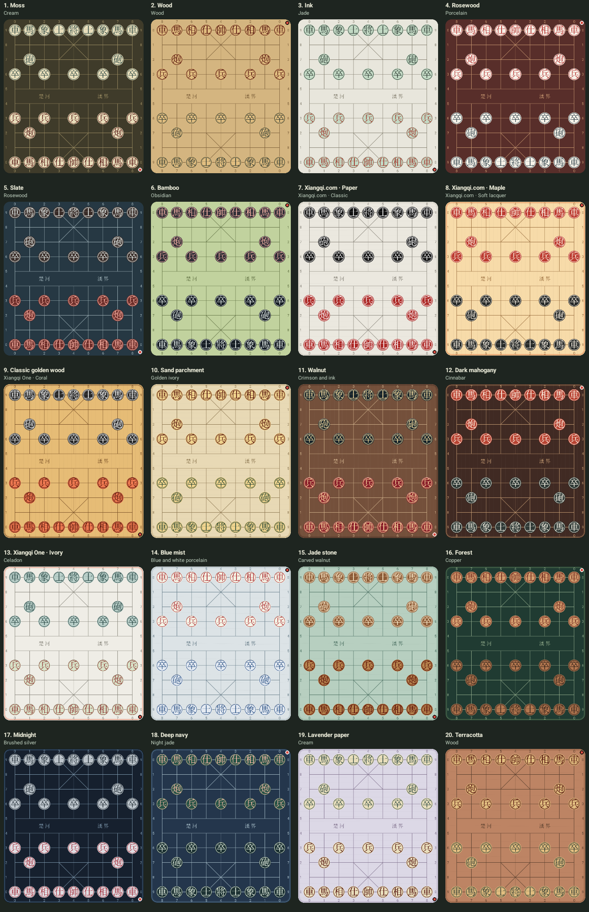
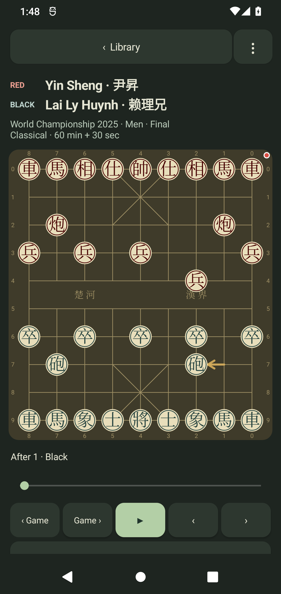
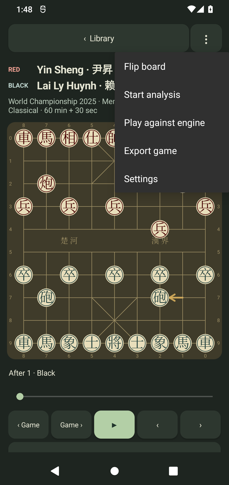

# Xiangqi Study 0.4.0 — appearance and game-controls audit

Date: 2026-10-28. Delivery: `dist/XiangqiStudy-latest.apk`.

## Corrected behavior

Custom colors formerly survived every preset selection, so the preset changed
in preferences but remained visually covered. The old regression test even
expected that incorrect behavior. Preset and custom-color operations now have
explicit precedence:

- Selecting a board preset clears only the custom board RGB.
- Selecting a piece preset clears both custom piece backgrounds.
- A later custom RGB replaces only that surface's preset color.
- Reselecting the same preset is a real selection and clears its older override.
- Opening settings, changing glyphs/coordinates/results, cancelling a picker or
  recreating the Activity preserves unrelated custom colors.

An explicit single-choice preset dialog handles same-item reselection. Its
Spinner uses dialog mode to avoid native drag-forwarding opening an alternate
selector. Initial framework callbacks do not count as user selections. Dialogs
are dismissed with the Activity, including during recreation. Its click handler
emits the accessibility click event without opening a second native selector.

## Presets and controls

There are 20 board palettes and 18 Chinese-character piece finishes. The first
six stable IDs remain compatible with old preferences. [Appearance sources](APPEARANCE-SOURCES.md)
records the inspected Xiangqi.com and Android app references, chosen colors and
original Canvas adaptations. Wood/paper/stone textures and frames are drawn in
code; selecting custom RGB suppresses material tint. Glyph contrast is at least
4.5:1 in the rendering audit. International-symbol pieces are never offered.

The five replay controls are, in the requested order: Previous game, Next game,
Play, Previous move, Next move. Game navigation follows the library's filter and
sort order, stops at the ends and restores each game's study position. The slider
still reaches every position, including the first and last.

The top-right Game menu offers Flip board, Start/Stop analysis, Play against
engine, Export game and Settings. Engine play starts at the current position,
lets the user choose Red or Black, validates the computer's reply and preserves
the source record. The configured finite time limit is used, or three seconds
per move when analysis is untimed. Analysis defaults remain untimed depth 128,
all available cores and adaptive hash. Stop playing retains the variation.

Independent review found two new lifecycle refresh gaps while implementing this
mode: backgrounding during a computer turn and restarting from a terminal board
could leave stale thinking/Stop-playing controls after cancellation. Both now
refresh the replay state. Generation and root-ply guards reject obsolete replies
after navigation, cancellation, replacement or Activity destruction.

## Validation rounds

| Check | Result |
| --- | --- |
| Rules/parser/search/UCI | 170 assertions pass |
| Date ordering | 27 assertions pass |
| Shared preset catalog | 186 assertions pass |
| Romanized source-name coverage | 354 assertions pass |
| Full preloaded collection | All 337 games / 28,177 plies replay legally |
| Production native adapter / official Windows executable | 35 assertions pass |
| Full Android 12 emulator suite | 42 tests pass in 215.789 seconds; 40 execute UI/repository/rendering checks, while two native-only cases log NOT_RUN on x86 |
| Actual Android 12 ARM64 engine | This APK was not run on the phone: it disconnected before the install. The identical official engine/network passed two physical-phone tests in 0.3; see that report for the narrower scope |
| Clean native and audit builds | Pass |
| Android lint | No issues found |
| APK ZIP, corpus, engine/network bytes and signature | Pass; exact official release payload and v2 signature verified |

The runtime suite adds explicit same-preset reselection and independent-surface
checks, renders all catalog entries, and exports the actual-renderer gallery.
Game-control tests exercise visible popup menu rows with real touchscreen input,
actual legal computer replies, saved-ply navigation, pending-job cancellation and
HOME/resume. Earlier library paging, long-import, coordinates, spoiler hiding,
Chinese-only glyphs, replay stability and import atomicity regressions remain.

The first full run was obstructed by the emulator's System UI ImageWallpaper
ANR dialog, verified from its focused window and event log. Its failures remain
in `test-results/android12-04-round2.txt`; the dialog was dismissed before rerunning.
The new test helpers also needed case-insensitive Android dialog-button matching,
a realistic finite search budget, and actual row taps for framework popup menus.
These were test-harness corrections. They did not replace the production menu
actions with reflective calls. Intermediate logs are retained rather than
presented as passing runs.

The corpus and rules remain unchanged from [0.3](AUDIT-0.3.md), whose independent
1,377-position native corpus comparison is retained as historical evidence.
Current core replay and native-adapter checks were rerun. Emulator tests execute
the Java fallback; native-only emulator cases explicitly log NOT_RUN. Their
separate ARM64 phone run belongs to 0.3; this APK could not repeat it after the
phone disconnected. This is a regression audit, not proof
that every possible app state is bug-free or a full tournament arbiter.

## Engine and delivery

Both production preBuild and final APK verification queried the official latest
stable release. It remains Pikafish 2026-09-06 with the matching official NNUE.
Archive-derived metadata, executable/network hashes, source pointers and licenses
are verified by `scripts/sync-pikafish.py`; failed online checks stop the build.
The app itself remains offline and requests no Internet permission.

The verified APK is 51,949,583 bytes, SHA-256
`928030905825772c626e66b4cf0074ca641bb6c0b152242773d9efc6a198fcad`.
The build script atomically replaces the previous delivery before removing older
Xiangqi Study APKs. Only the latest phone APK is kept in `dist`; portable audit
artifacts remain ignored under `test-results`.

