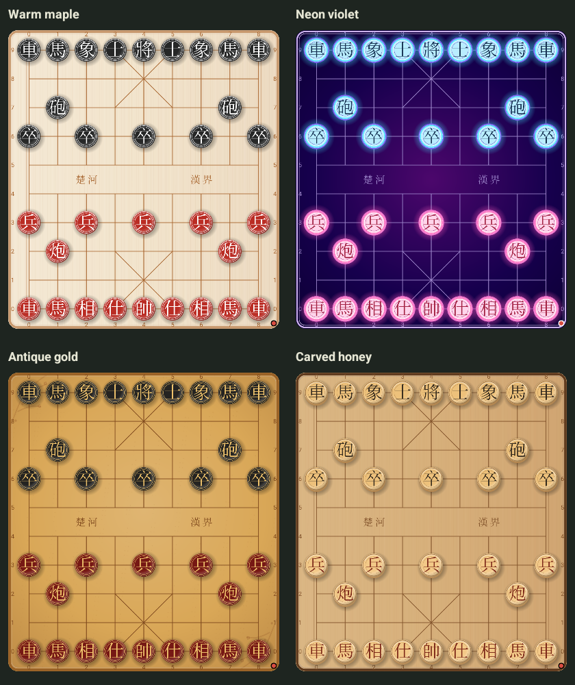

# Xiangqi Study 0.5.0 — four reference styles

Date: 2026-10-28. Delivery: `dist/XiangqiStudy-latest.apk`.

## Requested appearance

Four matching board/piece presets were appended without changing the existing
20 board or 18 piece preference IDs. There are now 24 boards and 22 Chinese-only
piece finishes. Choose the same name under Board style and Piece finish:

| Pair | Details |
| --- | --- |
| Warm maple | Light vertical grain, warm double rails, beveled black/Red pieces with white glyphs, rims and shadows |
| Neon violet | Deep violet with a central magenta bloom, pink/cyan piece halos, pale faces and dark Chinese characters |
| Antique gold | Gold parchment patina, original corner branches/blossoms, dark lacquer pieces with gold characters and beaded rims |
| Carved honey | Honey wood and brown frame, raised carved faces, layered bevels and lower-right shadows |

These are original procedural Canvas adaptations of the supplied references.
The reference screenshots are not modified, embedded or redistributed. The
board draws only Chinese river labels, piece characters and optional coordinates;
there is no URL or domain text on the playing surface. Source references remain
in [appearance documentation](APPEARANCE-SOURCES.md).

The new effects preserve the existing intersection geometry, coordinate toggle,
touch targets, move/best-move arrows and side-to-move dot. Halos and shadows are
drawn before piece faces to avoid washing out neighboring characters. Custom
board RGB suppresses material tint, and custom piece faces remain exact opaque
RGB. The latest-selection precedence fix and all game controls remain intact.

## Verification

| Check | Result |
| --- | --- |
| Core rules/parser/search/UCI | 170 assertions pass |
| Date ordering | 27 assertions pass |
| Catalog, contrast, matching pairs and migration IDs | 244 assertions pass |
| Romanized name coverage | 354 assertions pass |
| Full preload | All 337 games / 28,177 plies replay legally |
| New reference render tests | Both pass in 3.802 seconds; the matched 2×2 gallery was exported and visually inspected |
| Full Android 12 emulator suite | 44 tests pass in 334.324 seconds; 42 run UI/repository/rendering checks and two native-only cases log NOT_RUN on x86 |
| Clean build, lint, native payload and signature | Native and portable builds pass; lint has no issues; exact payload and APK v2 signature verify |
| Actual Android 12 ARM64 | Both native tests pass on this APK in 31.074 seconds: 15 recorded/custom/check/variation positions and untimed cancellation |

The new renderer tests record every text draw, reject URL/domain text, require
32 Chinese piece glyphs and at least 4.5:1 glyph contrast, compare geometry with
coordinates off/on and both orientations, and verify exact custom RGB pixels.
A separate 2×2 gallery pairs each new board with its matching piece finish;
the generic catalog gallery does not imply that differently indexed board/piece
lists are intended pairs.

Independent source review checked the new materials, shader/alpha cleanup,
halo/face drawing order, custom-color behavior and lack of URL drawing. The full
regression suite retains preset reselection, import atomicity, long records,
stable board layout, library navigation, menu actions and computer replies.
Emulator native-only cases explicitly log NOT_RUN; real ARM64 execution is
reported separately when a compatible phone is available.

## Build delivery

The native build and final APK verifier query the official latest stable
Pikafish release and verify the matching NNUE and licenses against its archive.
Failed online or integrity checks stop production builds. The previous APK stays
available until a verified replacement is ready; old delivery APKs are then
removed. Internal portable test APKs are not phone deliveries.

The [0.4 audit](AUDIT-0.4.md) and earlier reports remain historical evidence.
Passing regression checks does not prove every possible state is bug-free.

Final APK: 51,954,199 bytes, SHA-256
`2192095ab7f7bd107d1ab47002b1a0989f3fc60cb61a789b496933cf68d0dae3`.
The live official release check confirmed Pikafish 2026-09-06 and its matching
NNUE before compilation and again during final APK verification.

