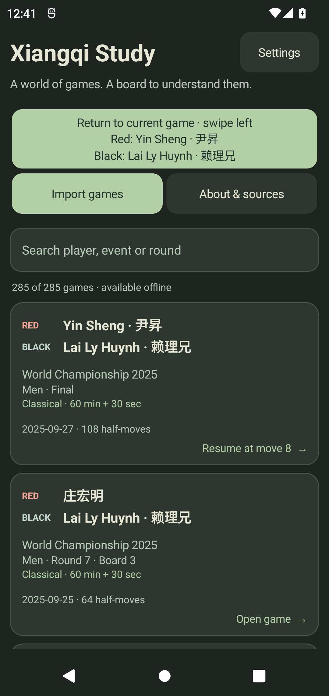
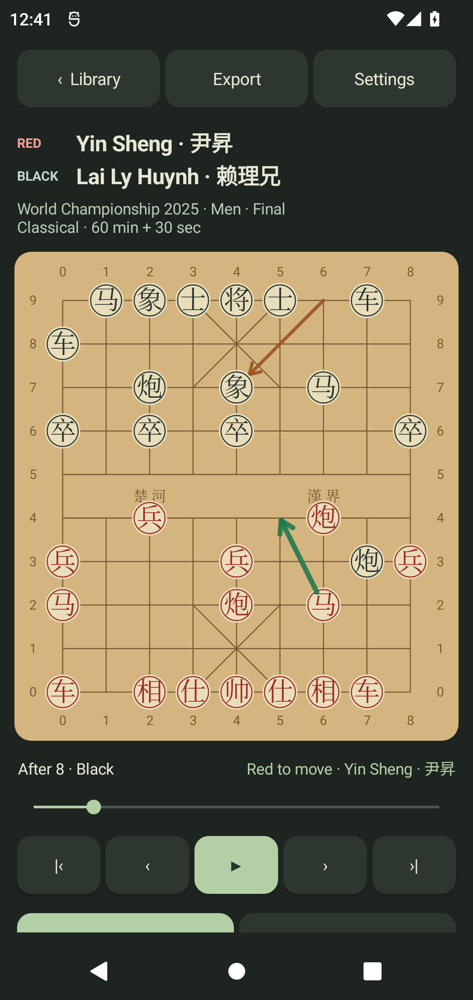
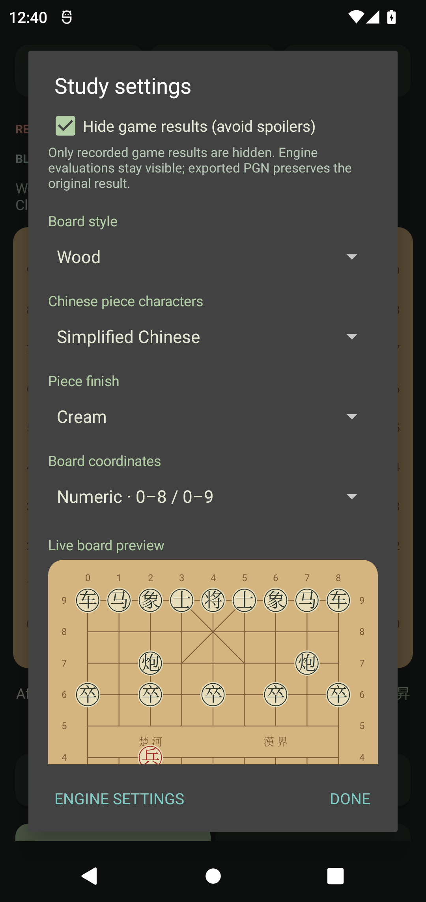
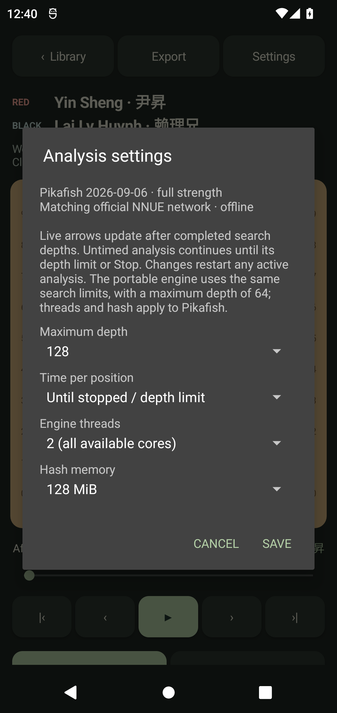
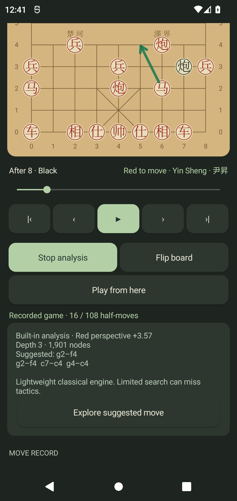
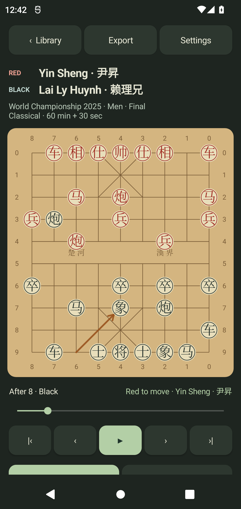

# Xiangqi Study 0.2.0 audit - 2026-10-28

## Install the replacement

Use `C:\Dev\PlayGround\XiangQi\dist\XiangqiStudy-latest.apk` on an Android 12
ARM64 phone. The versioned copy is `XiangqiStudy-0.2.0-android12-arm64.apk`.
Install over 0.1.0 to keep private imported games and study positions.
The portable Java-engine build is `dist/XiangqiStudy-portable-latest.apk`.
APKs are generated local deliveries; source, tests and notices are in Git.

| APK | Bytes | SHA-256 |
| --- | ---: | --- |
| ARM64 0.2.0 / `XiangqiStudy-latest.apk` | 51,901,947 | `b13ef5dd73df82e33a5cc757b08c1425bae14736bf3dbddd444f0b92d3c0c51a` |
| Portable 0.2.0 / `XiangqiStudy-portable-latest.apk` | 185,347 | `0f1bb7da2efae66d74d68911236adc334430f683764a043dcfcf10f0dc79748b` |

## Defects found and corrected

1. **Native analysis failed for the entire preload.** Bundled games omit the
   optional starting FEN. The UI supplied an empty string to `UciPosition`, which
   tried to parse it as a ten-rank board. Blank/null now means the normal starting
   board, consistent with replay. Full move history still reaches Pikafish, so
   analysis works at intermediate recorded and variation positions.
2. **Some PGN imports could crash or lose moves.** A long quoted header caused a
   regex stack overflow; CR-only line endings could consume the remainder of a
   game as a comment. Those cases are fixed. `SetUp=1` without a FEN is rejected.
3. **Some JSON imports could crash or accept a valid prefix.** Android's parser
   overflowed its stack on 10,000 nested arrays (only 20 KB). A quote/comment-aware
   32-level preflight rejects excessive nesting before recursive parsing.
   Trailing junk is rejected atomically; quoted bracket text remains valid.
4. **Imports could race Activity recreation or another repository instance.**
   Shared serial I/O survives recreation, URI read/validate/save stays in one
   background task, and a storage lock plus reload-before-commit prevents stale
   instances overwriting newer imports. Interrupted atomic writes recover.
5. **PGN and saved JSON had inconsistent limits.** Both now enforce 2,000
   half-moves per imported game. File size and metadata limits are enforced in
   the repository, independently of UI entry points.
6. **A corrupt copied network broke later searches.** The adapter verifies exact
   network size and SHA-256 and replaces damaged copies atomically.
7. **Terminal native scores could show the wrong winner.** UCI `mate 0` now means
   the side to move has lost. Large ordinary centipawn scores are kept distinct
   from mate scores. Terminal boards display checkmate/stalemate explicitly.
8. **Native Android compatibility was too broad.** The official ARM64 executable
   declares API 29. Availability is now gated to API 29+; Android 12 is API 31.
9. **Library navigation hid the current study.** A visible return button and
   horizontal swipes restore its exact replay/variation position. Slider
   scrubbing, text entry, spinners and multitouch are excluded from page swipes.

## Requested controls

- Separate **RED** and **BLACK** player rows in cards and replay; the turn label
  includes the player name.
- Persistent result hiding, enabled by default, including accessibility text.
  This hides recorded outcomes, while analysis evaluations remain visible and
  exports retain the original result.
- Moss/Wood/Ink boards; Traditional/Simplified Chinese characters only;
  Cream/Wood/Jade piece finishes; live preview.
- Off/ICCS/Numeric file and rank coordinates, kept correct when flipped.
- Played-move arrows instead of source/destination tiles. A separate best-move
  arrow and score/PV update from validated exact native search output. Stop
  retains the latest estimate; navigation clears stale arrows/results.
- Depth 12-128, timed or untimed search, all available CPU cores by default,
  configurable threads and hash. Default hash is RAM-aware (64/128/256 MiB).
  Saving engine controls restarts an active search. No strength handicap is
  applied; one principal variation dedicates the search to the best line.

## Engine and corpus verification

Official releases and the live release API were checked on 2026-10-28. The latest
stable release remains [Pikafish 2026-09-06](https://github.com/official-pikafish/Pikafish/releases/tag/Pikafish-2026-09-06).
The existing bundled executable and matching NNUE are byte-identical to that
official package. Hashes and licenses are in `third_party/pikafish/UPSTREAM.md`.

| Check | Result |
| --- | --- |
| Java rules/parser/search/UCI regressions | 168 assertions pass |
| Initial perft | 44 / 1,920 / 79,666 |
| Independent legal-move oracle | Exact agreement with official Pikafish across 259 positions |
| Full preload replay | All 285 games / 23,340 half-moves legal |
| Native corpus sampling | 1,169 positions across all 285 games and custom check/endgame/variation fixtures pass |
| Native searches in corpus sampling | 1,145 legal best moves; 24 terminal boards agree on zero legal moves |
| Production native adapter harness | 34 assertions pass, including actual blank/null FEN input, changed live best moves, resource commands, network repair, failures and cancellation |
| Both APK payloads | Exact corpus, provenance, curation, canonical moves and upstream payload hashes verified |
| ARM64 APK signature | APK v2 signature verifies |
| Clean ARM64 and portable build/lint | Pass; lint reports no issues |
| Android 12/API 31 full device suite | All 19 tests pass in 94.857 seconds |

The device suite covers player search, first/last/previous/next replay,
autoplay/pause, slider seeking, actual left/right touch swipes, protection of
slider gestures, current-game return, variations across games and Activity
recreation, completed/live analysis and cancellation, queued imports during
recreation, atomic repository failures, parser/size limits and saved settings.
The accessibility slider check waits for the asynchronous Android accessibility
tree before interacting; the final combined run passes all tests.

The adapter harness compiles the production `PikafishEngine.java` with test-only
Android Context stubs and executes real official Windows Pikafish plus isolated
failure fixtures. Corpus sampling uses production `UciPosition` commands and
compares the complete legal-move set against native perft 1 before searching.
These tests cover the previously missed UI-to-engine input path.

Actual Android document-provider export/import was exercised, including the
source result and `3600+30` time control surviving PGN export and duplicate
records being recognized on import.

## Limits of this evidence

Android 12 emulator tests exercise the Java engine and Android UI. Windows tests
execute the production adapter and official engine protocol, but do not execute
ARM64 Android machine code. The installed emulator rejects ARM64 guests on this
Windows host. **Execution on the physical Android 12 ARM64 phone remains a
separate device check.** The reported ten-rank FEN failure is reproduced and
fixed by the adapter regressions.

The Java engine is a lightweight fallback. Replay is not a full WXF repetition,
perpetual-chase or tournament arbiter. Native Pikafish receives history and
applies its own rules. The 5,000-import storage limit is a validation boundary;
large-library UI performance has not been stress-tested at that maximum.

## Reproduce

```powershell
.\scripts\test-core.ps1
python scripts/audit-moves.py --engine C:\path\Pikafish-Windows-x86-64-universal.exe
python scripts/test-native-adapter.py --engine C:\path\Pikafish-Windows-x86-64-universal.exe
python scripts/test-native-pack.py --engine C:\path\Pikafish-Windows-x86-64-universal.exe
.\scripts\build.ps1 -Portable -Check
adb install -r dist/XiangqiStudy-portable-latest.apk
adb install -r app/build/outputs/apk/androidTest/debug/app-debug-androidTest.apk
adb shell am instrument -w org.xiangqi.study.test/android.test.InstrumentationTestRunner
.\scripts\build.ps1 -Check
python scripts/verify-apk.py dist/XiangqiStudy-latest.apk
```

Use the matching `pikafish.nnue` next to the Windows executable or pass the
scripts' `--network` option. Generated transcripts and diagnostics are under
ignored `test-results/`; Android stubs and failure fixtures are test-only.

## Inspected Android 12 screenshots

These are actual emulator captures using the explicitly labelled portable
engine. Settings and board controls are the same in the ARM64 APK.







