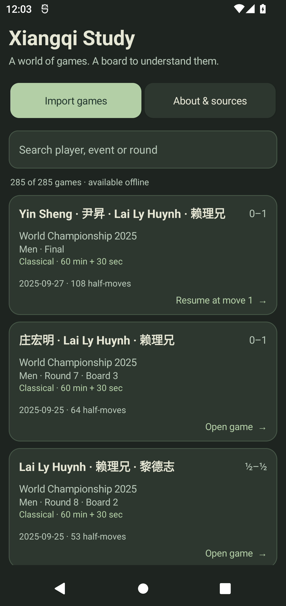
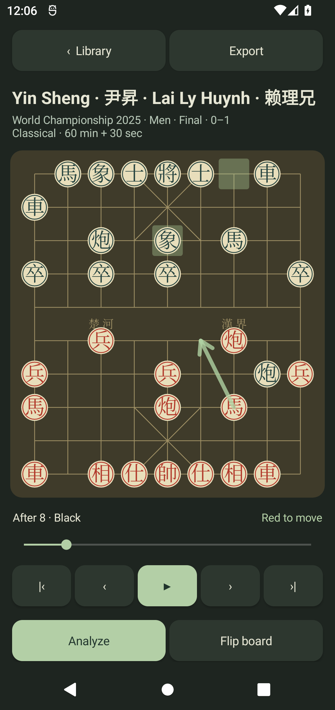
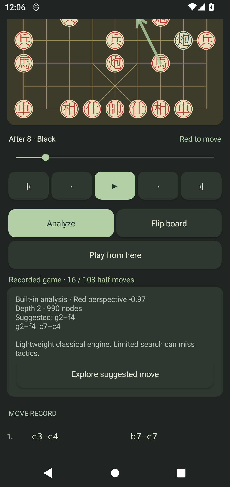

# Validation - 2026-10-28

> Historical 0.1.0 checks. A later audit found and fixed native starting-FEN and
> import/persistence defects missed by these checks. Use the 0.2.0 APK and read
> [AUDIT.md](AUDIT.md) for the expanded validation and current behavior.

## Delivered builds

Both APKs are debug-signed, version 0.1.0, package `org.xiangqi.study`, minimum
API 26 and target API 35. Android 12 is API 31.

| Local delivery | Size | SHA-256 |
| --- | ---: | --- |
| `dist/XiangqiStudy-0.1.0-android12-arm64.apk` | 51,885,971 bytes | `3d7d6b33713e92472f373c7a5cad9be1a31fe9aee49af03308775a695a2e0e40` |
| `dist/XiangqiStudy-0.1.0-android12-portable.apk` | 169,371 bytes | `7b1fcb97aef397c1ab3958a09f1e63f5a269376495abc92c2750b2ecbb1c4721` |

The APKs are generated local deliveries in ignored `dist/`; build them from the
checked-in source with `scripts/build.ps1`, adding `-Portable` for the small
Java-engine build. No signing keys or private runtime state are committed.

## Checks completed

- Clean ARM64 and portable Gradle builds pass; Android lint reports **no issues**.
- Android `apksigner verify --verbose` passes for both APKs (v2 signatures).
- `scripts/verify-apk.py` confirms both packages contain the exact 285-game
  classical pack and 23,340 half-moves. It verifies the ARM64 executable and NNUE
  against the exact upstream hashes, and confirms the portable APK omits them.
- Pure Java core: **146 assertions**, including initial-position perft
  `44 / 1920 / 79666`, movement restrictions, check legality, imports, UCI
  history/score/PV parsing and cancellation.
- Independent Java replay: **all 285 games / 23,340 half-moves legal**.
- Actual official Windows Pikafish protocol: Red and Black history commands,
  completed scores, best moves and legal principal variations pass. This tests
  production UCI parsing, rather than Android machine code.
- Android 12/API 31 x86_64 emulator: **4 instrumentation tests pass**, final run
  9.692 seconds. Tests cover real bundled games, legal import/persistence,
  duplicate detection, atomic invalid-batch rejection, JSON normalization,
  impossible FEN rejection, export round trip, replay navigation and analysis
  cancellation.
- Manual Android 12 checks: seek to half-move 16 of the men's final; complete a
  local analysis; open the suggested move as a separate variation; return to the
  original 108-half-move record. Runtime error log contains no app crashes.
- Screenshots inspected directly: library, replay with suggested-move arrow,
  and completed analysis. Outer board pieces fit inside all four margins after
  correcting a visual defect found during inspection.

## Scope of runtime evidence

The emulator uses the portable Java engine, and the analysis screenshot labels
it accordingly. The ARM64 APK contains the verified official Pikafish binary and
network. **ARM64 Android execution and installation on Daniel's physical phone
have not been tested.** This is the remaining device-specific verification.

The lightweight engine is for basic study and can miss tactics. Tournament
repetition/chase adjudication is not implemented by the replay board. Native
Pikafish receives the complete starting-position and move history; its rules
should not be presented as a complete WXF match arbitration service.

## Screenshots

